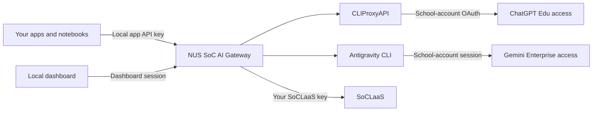

# NUS SoC AI Gateway

[](https://github.com/mysterious-joker/nus-soc-ai-gateway/actions/workflows/ci.yml)
[](LICENSE)
[](https://nodejs.org/)

**One local interface for the AI access you already have at NUS School of Computing.**

Connect ChatGPT Edu, Gemini Enterprise through Antigravity CLI, and SoCLaaS to a dashboard and an OpenAI-compatible local API. Discover models, verify access with your account, and track usage without configuring every provider in every app.

This is an independent community project, not an official NUS, OpenAI, or Google service. Each student runs their own gateway with their own authorized accounts. It does not provide accounts, pool students' credentials, merge credits, or bypass subscription limits.

## How it works



The gateway key authenticates your apps to `localhost`; it is not an OpenAI or Google developer API key. ChatGPT requests reuse account OAuth through CLIProxyAPI. Gemini requests run through the authenticated CLI. SoCLaaS uses its issued key directly. No separately billed OpenAI API-key or Vertex fallback is configured.

## Features

- **Live discovery:** account catalogs, CLI enumeration, bridge candidates and realtime session metadata; no fixed model-ID list in gateway code.
- **Verified access:** only account-scoped model/endpoint combinations with successful checks enter the client-facing catalog.
- **Clear organization:** language, embedding, image and speech models, with provider labels and discovery provenance.
- **Usage visibility:** provider-reported token counts per model and source, plus remaining quota where available.
- **Local playground:** chat, embeddings, image generation/editing, transcription and speech playback.
- **Local access controls:** separate dashboard and app credentials, institutional identity checks, CSRF protection and loopback-only listeners.

## Connections and capabilities

| Source            | Authentication                                   | Implemented capabilities                                                                                     |
| ----------------- | ------------------------------------------------ | ------------------------------------------------------------------------------------------------------------ |
| ChatGPT Edu       | Verified `@u.nus.edu` OAuth through CLIProxyAPI  | Chat, Responses, image generation/editing, realtime audio and speech synthesis, subject to discovered access |
| Gemini Enterprise | Antigravity CLI session using `@comp.nus.edu.sg` | Text chat and Responses, including streaming and discovered reasoning variants                               |
| SoCLaaS           | Your SoCLaaS API key                             | Chat, Responses, embeddings and transcription where returned and verified                                    |

Availability depends on your account, institutional configuration and connector version. Aliases and reasoning variants may be separate entries. Connected catalogs do not enumerate every feature of the ChatGPT or Gemini websites. Gemini image, music and video generation are not implemented here.

## Quick start

The full subscription workflow is tested on **macOS**. Use Node.js **22.13+**; `.nvmrc` selects Node 24. Install [CLIProxyAPI 8.x](https://github.com/router-for-me/CLIProxyAPI) for ChatGPT and [Antigravity CLI](https://antigravity.google/docs/cli/) for Gemini. They are separate dependencies and are not bundled. See [setup](docs/setup.md) for paths, login and compatibility details.

```sh
git clone https://github.com/mysterious-joker/nus-soc-ai-gateway.git
cd nus-soc-ai-gateway
npm ci
npm start
```

In a second terminal in the same folder:

```sh
npm run open
```

1. Connect your available sources in **Sources**. You do not need all three.
2. Verify selected models with the [verification commands](docs/verification.md). New entries stay out of `/v1/models` until checks pass. Live checks consume allowance.
3. Create an **App API key** in Sources and use `http://localhost:4000/v1` as your client's base URL.

```sh
export NUS_GATEWAY_KEY='YOUR_LOCAL_GATEWAY_KEY'
curl http://localhost:4000/v1/models \
  -H "Authorization: Bearer $NUS_GATEWAY_KEY"
```

Use an exact model ID from that response. See [API usage](docs/api.md) for requests, streaming, uploads and WebSockets.

## Quotas and privacy

Allowances remain separate at each source. The gateway records reported usage; it does not convert tokens into money or infer balances. Gemini and SoCLaaS balances may be unavailable in the dashboard. A successful request proves access at that time, not universal entitlement or a guarantee about institutional billing policy.

Credentials, databases, local reports and generated media stay in ignored directories. The gateway's usage log contains metadata and token counts, not prompts or replies. Upstream providers and the CLI have their own retention behavior. This is a personal localhost service, not a shared or internet-facing host.

## Documentation

- [Setup and troubleshooting](docs/setup.md)
- [API usage and compatibility](docs/api.md)
- [Discovery, verification and quotas](docs/verification.md)
- [Architecture and storage](docs/architecture.md)
- [Security policy](SECURITY.md)
- [Contributing](CONTRIBUTING.md)
- [Changes](CHANGELOG.md)

## Development

```sh
npm ci
npm run check
npm run format:check
npm test
```

Tests use temporary directories and mocked services. CI never uses institutional accounts or runs live generation.

## License and acknowledgements

[MIT](LICENSE). Built with [CLIProxyAPI](https://github.com/router-for-me/CLIProxyAPI), the separately installed [Antigravity CLI](https://antigravity.google/docs/cli/), and [ws](https://github.com/websockets/ws). Third-party software and services retain their respective licenses and terms. Use this project within your provider and institutional access policies.
