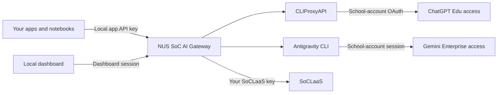

# NUS SoC AI Gateway

[](https://github.com/mysterious-joker/nus-soc-ai-gateway/actions/workflows/ci.yml)
[](LICENSE)
[](https://nodejs.org/)

**One local interface for the AI access you already have at NUS School of Computing.**

Connect ChatGPT Edu, Gemini Enterprise through Antigravity CLI, and SoCLaaS to a dashboard and an OpenAI-compatible local API. Discover models, verify access with your account, and track usage without configuring every provider in every app.

This is an independent community project, not an official NUS, OpenAI, or Google service. Each student runs their own gateway with their own authorized accounts. It does not provide accounts, pool students' credentials, merge credits, or bypass subscription limits.

## How it works



The gateway key authenticates your apps to `localhost`; it is not an OpenAI or Google developer API key. ChatGPT requests reuse account OAuth through CLIProxyAPI. Gemini requests run through the authenticated CLI. SoCLaaS uses its issued key directly. No separately billed OpenAI API-key or Vertex fallback is configured.

## Features

- **Live discovery:** account catalogs, CLI enumeration, bridge candidates and realtime session metadata; no fixed model-ID list in gateway code.
- **Verified access:** only account-scoped model/endpoint combinations with successful checks enter the client-facing catalog.
- **Clear organization:** language, embedding, image and speech models, with provider labels and discovery provenance.
- **Usage visibility:** provider-reported token counts per model and source, plus remaining quota where available.
- **Local playground:** chat, embeddings, image generation/editing, transcription and speech playback.
- **Local access controls:** separate dashboard and app credentials, institutional identity checks, CSRF protection and loopback-only listeners.

## Connections and capabilities

| Source            | Authentication                                   | Implemented capabilities                                                                                     |
| ----------------- | ------------------------------------------------ | ------------------------------------------------------------------------------------------------------------ |
| ChatGPT Edu       | Verified `@u.nus.edu` OAuth through CLIProxyAPI  | Chat, Responses, image generation/editing, realtime audio and speech synthesis, subject to discovered access |
| Gemini Enterprise | Antigravity CLI session using `@comp.nus.edu.sg` | Text chat and Responses, including streaming and discovered reasoning variants                               |
| SoCLaaS           | Your SoCLaaS API key                             | Chat, Responses, embeddings and transcription where returned and verified                                    |

Availability depends on your account, institutional configuration and connector version. Aliases and reasoning variants may be separate entries. Connected catalogs do not enumerate every feature of the ChatGPT or Gemini websites. Gemini image, music and video generation are not implemented here.

## Quick start

### Desktop app

Download your installer from [GitHub Releases](https://github.com/mysterious-joker/nus-soc-ai-gateway/releases/latest): macOS (Apple Silicon or Intel), Windows x64, or Linux x64. Open **NUS SoC AI Gateway**; it starts the local service and unlocks the dashboard automatically. Desktop users do not need Node.js, npm or Homebrew.

1. **Connect a source.** For ChatGPT, click **Prepare ChatGPT connection**, then sign in with your school account. The app downloads a pinned, checksum-verified CLIProxyAPI release. SoCLaaS needs only your key. Gemini requires a separately installed and signed-in [Antigravity CLI](https://antigravity.google/docs/getting-started?tab=cli).
2. **Verify access.** Open **Models → Verify all models** to check every detected model's supported endpoints using minimal prompts and bundled media inputs. Watch progress or cancel at any time. This consumes provider allowance; only successful model/endpoint checks become available to apps. Use **Verify** beside one model for a targeted Playground check. See [verification details](docs/verification.md) for token limits and probe coverage.
3. **Connect your app.** Create an app key in Sources, copy the displayed API base URL, and choose a verified model in your OpenAI-compatible client. Keep the gateway open while using it.

The complete live subscription workflow has been checked on macOS. Builds and synthetic startup checks cover released platforms; they do not prove institutional access on every OS. **Gemini CLI integration is not enabled on Windows.** The first desktop release is unsigned and not notarized; see [installation and platform notes](docs/setup.md).

### Run from source

Use Node.js **22.13+** (Node 24 recommended) and npm:

```sh
git clone https://github.com/mysterious-joker/nus-soc-ai-gateway.git
cd nus-soc-ai-gateway
npm ci
npm run desktop
```

For a browser-only gateway, run `npm start`, then in a second terminal:

```sh
npm run open
```

The launcher supports macOS, Windows and Linux. The browser-only server defaults to port 4000; desktop selects a free port if occupied. Always copy the address shown in Sources. Desktop and source-server profiles are separate; existing source data remains untouched. See [setup](docs/setup.md) for migration and configuration.

```sh
export NUS_GATEWAY_KEY='YOUR_LOCAL_GATEWAY_KEY'
curl http://localhost:4000/v1/models \
  -H "Authorization: Bearer $NUS_GATEWAY_KEY"
```

Use an exact model ID from that response. See [API usage](docs/api.md) for requests, streaming, uploads and WebSockets.

## Quotas and privacy

Allowances remain separate at each source. The gateway records reported usage; it does not convert tokens into money or infer balances. Gemini and SoCLaaS balances may be unavailable in the dashboard. A successful request proves access at that time, not universal entitlement or a guarantee about institutional billing policy.

Credentials, databases, local reports and generated media stay in ignored directories. The gateway's usage log contains metadata and token counts, not prompts or replies. Upstream providers and the CLI have their own retention behavior. This is a personal localhost service, not a shared or internet-facing host.

## Documentation

- [User-friendly API reference](http://localhost:4000/reference) — served by your running gateway; also linked from its header.
- [Download the OpenAPI contract](public/openapi.json) — request/response schemas, authentication and errors.
- [Setup and troubleshooting](docs/setup.md)
- [API usage and compatibility](docs/api.md)
- [Discovery, verification and quotas](docs/verification.md)
- [Architecture and storage](docs/architecture.md)
- [Security policy](SECURITY.md)
- [Contributing](CONTRIBUTING.md)
- [Changes](CHANGELOG.md)

## Development

```sh
npm ci
npm run check
npm run format:check
npm test
npm run test:desktop
npm run build:desktop
```

Tests use temporary directories and mocked services. Desktop CI builds native installers and runs real renderer/startup checks on macOS, Linux and Windows. CI never uses institutional accounts or runs live generation. See [release engineering](docs/releases.md).

## License and acknowledgements

[MIT](LICENSE). Built with Electron, CLIProxyAPI, the separately installed Antigravity CLI and the libraries listed in [third-party notices](THIRD_PARTY_NOTICES.md). Use this project within your provider and institutional access policies.
